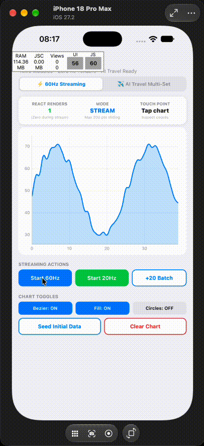
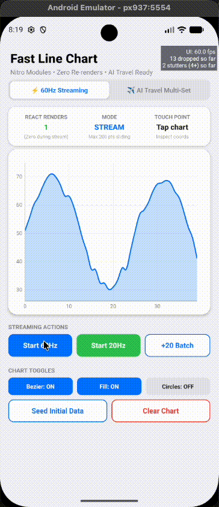

# @2security/fast-line-chart

[](https://www.npmjs.com/package/@2security/fast-line-chart)
[](https://www.npmjs.com/package/@2security/fast-line-chart)
[](LICENSE)

An ultra-fast real-time streaming LineChart component for React Native built with Nitro Modules, delivering 60/120 FPS native performance with zero JS re-renders and hardware VSync throttling.

## 📱 Preview

| iOS Preview | Android Preview |
| :---: | :---: |
|  |  |

## ✨ Features

- ⚡ **Zero JS Re-renders** - Stream high-frequency points imperatively via ref without triggering React render passes
- 🏎️ **Hardware VSync Throttling** - Native redraws synchronized to screen refresh rate (60Hz / 120Hz ProMotion) via `CADisplayLink` (iOS) and `Choreographer` (Android)
- 🚀 **High Performance** - Built with Nitro Modules for direct C++/JSI invocation with microsecond bridge latency
- 📈 **Real-Time Streaming & Batching** - Smooth streaming with `appendPoint` and `appendPointsBatch` with bounded sliding windows (`maxPoints`)
- 📊 **Multi-Dataset Support** - Render multiple datasets with independent styles, fills, cubic Bézier / stepped curves, and custom markers
- 🎯 **Targeted Selection & Data Revision** - Precise point selection reporting layout pixel coordinates and `dataRevision` tags to prevent async race conditions
- 🎨 **Fully Customizable** - Granular control over X/Y axes, decimal/string formatters, grid lines, labels, and consecutive duplicate suppression
- 📱 **Cross-Platform Native Power** - Powered by industry-proven native engines: [DGCharts](https://github.com/danielgindi/Charts) on iOS and [MPAndroidChart](https://github.com/PhilJay/MPAndroidChart) on Android
- 🧪 **Production Ready** - Fully typed TypeScript API with comprehensive example app and unit tests

> **Note:** Streaming append methods operate on a single dataset. After setting multiple datasets, call `clearData()` or `setDataPoints()` before appending. On Android, the native chart stores coordinates as 32-bit floats, so use relative indices or offsets instead of large absolute values such as raw millisecond timestamps.

## 📦 Installation

```sh
npm install @2security/fast-line-chart react-native-nitro-modules
# or
yarn add @2security/fast-line-chart react-native-nitro-modules
```

> **Note:** `react-native-nitro-modules` is required as this library relies on [Nitro Modules](https://nitro.margelo.com/) for native performance.

## 📱 Expo Usage

This library uses native code and **cannot** be used with Expo Go. You must use [Development Builds](https://docs.expo.dev/develop/development-builds/introduction/).

### 1. Installation

```sh
npx expo install @2security/fast-line-chart react-native-nitro-modules
```

### 2. Run with Development Build

```sh
npx expo run:ios
# or
npx expo run:android
```

## 🚀 Quick Start

### 1. Static Multi-Dataset Chart

Ideal for price trends, comparisons, or analytical dashboards:

```tsx
import React from 'react';
import { View } from 'react-native';
import { FastLineChartView } from '@2security/fast-line-chart';

export const PriceChart = () => {
  return (
    <View style={{ flex: 1, padding: 16 }}>
      <FastLineChartView
        style={{ height: 260 }}
        config={{
          xAxis: {
            position: 'BOTTOM',
            valueFormatter: ['Mon', 'Tue', 'Wed', 'Thu', 'Fri'],
            drawGridLines: false,
          },
          yAxis: {
            axisMinimum: 0,
            valueFormatter: '#,##0.0#M',
            drawGridLines: true,
          },
          maxVisibleValueCount: 100,
          animationDurationX: 500,
          pinchZoom: true,
          dragEnabled: true,
        }}
        dataSets={[
          {
            label: 'Flight Price',
            values: [
              { x: 0, y: 1.2 },
              { x: 1, y: 1.5 },
              { x: 2, y: 1.4 },
              { x: 3, y: 1.8 },
              { x: 4, y: 2.1 },
            ],
            config: {
              color: '#007AFF',
              lineWidth: 2,
              mode: 'CUBIC_BEZIER',
              drawFilled: true,
              fillColor: '#007AFF',
              fillAlpha: 0.15,
              drawValues: true,
              valueFormatter: ['1.2M', '1.5M', '1.4M', '1.8M', '2.1M'],
              hideConsecutiveDuplicateValues: true,
            },
          },
        ]}
        onSelectPoint={(point) => {
          console.log(`Selected (${point.x}, ${point.y}) at pixel (${point.pixelX}, ${point.pixelY})`);
        }}
      />
    </View>
  );
};
```

### 2. Real-Time Streaming Chart (Zero Re-renders)

Push telemetry or live financial ticks at 60Hz without triggering React re-renders:

```tsx
import React, { useRef, useEffect } from 'react';
import { View } from 'react-native';
import { FastLineChartView, type FastLineChartRef } from '@2security/fast-line-chart';

export const RealtimeChart = () => {
  const chartRef = useRef<FastLineChartRef>(null);

  useEffect(() => {
    let x = 0;
    const interval = setInterval(() => {
      x += 1;
      const y = Math.sin(x * 0.1) * 10 + 20;

      // Imperatively append point directly to the native chart (Sliding window of 100 points)
      chartRef.current?.appendPoint(x, y, 100);
    }, 16); // ~60 FPS

    return () => clearInterval(interval);
  }, []);

  return (
    <View style={{ flex: 1 }}>
      <FastLineChartView
        ref={chartRef}
        style={{ height: 260 }}
        config={{
          lineColor: '#34C759',
          lineWidth: 2,
          mode: 'CUBIC_BEZIER',
          drawFilled: true,
          fillColor: '#34C759',
          fillAlpha: 0.2,
          visibleRangeX: 50,
          autoScroll: true,
          drawGridLines: true,
        }}
      />
    </View>
  );
};
```

## 📚 API Reference

### Component

#### `<FastLineChartView />`

Core hybrid component rendering the native line chart.

```tsx
export interface FastLineChartViewProps extends ViewProps {
  config?: LineChartConfig;
  initialPoints?: Point[];
  dataSets?: LineChartDataSet[];
  onSelectPoint?: (point: SelectedPoint) => void;
}
```

---

### Methods (via `ref: FastLineChartRef`)

Access imperative chart methods by passing a `ref` to `<FastLineChartView ref={chartRef} />`:

| Method | Parameters | Description |
| :--- | :--- | :--- |
| `appendPoint` | `(x: number, y: number, maxPoints?: number)` | Appends a single point to the streaming dataset. Drops old points when `maxPoints` is exceeded. |
| `appendPointsBatch` | `(points: Point[], maxPoints?: number)` | Appends an array of points in a single native operation. |
| `setDataPoints` | `(points: Point[])` | Replaces single dataset points directly. |
| `setDataSets` / `setChartDataSets` | `(sets: LineChartDataSet[])` | Replaces all datasets on the chart. |
| `clearData` | `()` | Clears all data points and datasets from the chart. |
| `setVisibleXRangeMaximum` | `(maximum: number)` | Restricts the maximum visible X-axis range. |
| `moveViewToX` | `(x: number)` | Scrolls the chart horizontally to the specified X coordinate. |
| `fitScreen` | `()` | Resets zoom and pan scaling to fit the whole chart within viewport bounds. |

---

### Types

#### `Point`

```typescript
interface Point {
  x: number;
  y: number;
}
```

#### `SelectedPoint`

```typescript
interface SelectedPoint {
  x: number;
  y: number;
  pixelX: number; // In React Native layout units relative to chart
  pixelY: number; // In React Native layout units relative to chart
  dataIndex?: number;
  dataSetIndex?: number;
  dataRevision?: number; // Snapshot identifier matching dataSets[i].dataRevision
}
```

#### `LineChartDataSet`

```typescript
interface LineChartDataSet {
  values: Point[];
  label?: string;
  config?: LineDataSetConfig;
  dataRevision?: number; // Optional snapshot revision ID
}
```

#### `LineDataSetConfig`

```typescript
interface LineDataSetConfig {
  color?: ChartColor;
  lineWidth?: number;
  drawCircles?: boolean;
  circleColor?: ChartColor;
  circleRadius?: number;
  drawCircleHole?: boolean;
  circleHoleColor?: ChartColor;
  circleHoleRadius?: number;
  drawValues?: boolean;
  valueTextColor?: ChartColor;
  valueTextSize?: number;
  valueFormatter?: string[]; // Array indexed by X value
  hideConsecutiveDuplicateValues?: boolean; // Suppress duplicate adjacent labels
  mode?: 'LINEAR' | 'CUBIC_BEZIER' | 'STEPPED' | 'HORIZONTAL_BEZIER';
  drawFilled?: boolean;
  fillColor?: ChartColor;
  fillAlpha?: number; // 0.0 - 1.0
  highlightEnabled?: boolean;
}
```

#### `LineChartConfig`

```typescript
interface LineChartConfig {
  // Global & Axis Styling
  backgroundColor?: ChartColor;
  gridColor?: ChartColor;
  drawGridLines?: boolean;
  drawAxisLines?: boolean;
  drawLabels?: boolean;
  xAxisPosition?: 'TOP' | 'BOTTOM' | 'BOTH_SIDED' | 'TOP_INSIDE' | 'BOTTOM_INSIDE';
  xAxisValueFormatter?: string[];
  textColor?: ChartColor;
  textSize?: number;
  visibleRangeX?: number;
  autoScroll?: boolean;
  descriptionText?: string;
  legendEnabled?: boolean;
  dragEnabled?: boolean;
  scaleEnabled?: boolean;
  scaleXEnabled?: boolean;
  scaleYEnabled?: boolean;
  pinchZoom?: boolean;
  highlightEnabled?: boolean;
  extraOffsets?: ExtraOffsets;
  xAxis?: LineXAxisConfig;
  yAxis?: LineYAxisConfig;
  maxVisibleValueCount?: number;
  noDataText?: string;
  animationDurationX?: number;

  // Single-dataset convenience styling
  lineColor?: ChartColor;
  lineWidth?: number;
  drawCircles?: boolean;
  circleColor?: ChartColor;
  circleRadius?: number;
  drawCircleHole?: boolean;
  circleHoleColor?: ChartColor;
  circleHoleRadius?: number;
  drawValues?: boolean;
  valueTextColor?: ChartColor;
  valueTextSize?: number;
  valueFormatter?: string[];
  hideConsecutiveDuplicateValues?: boolean;
  mode?: 'LINEAR' | 'CUBIC_BEZIER' | 'STEPPED' | 'HORIZONTAL_BEZIER';
  drawFilled?: boolean;
  fillColor?: ChartColor;
  fillAlpha?: number;
}
```

## 🎯 Advanced Usage

### Zero Re-render Architecture

In conventional React Native chart libraries, updating live points triggers React state updates, leading to JavaScript reconciliation overhead, thread congestion, and dropped frames.

`@2security/fast-line-chart` provides direct JSI imperative handles:
- Calls to `appendPoint()` bypass React state entirely.
- Data flows directly over the C++ JSI bridge into native memory.
- React only mounts the container; the native chart handles continuous streaming independently.

### Data Revision & Selection Safety

When displaying asynchronously updated or paginated charts, race conditions can occur between asynchronous data fetches and user tap interactions:

1. Tag each dataset with an incremental `dataRevision` (e.g. `1`, `2`, `3`).
2. When the user taps a point, `onSelectPoint` includes the matching `dataRevision` of the dataset clicked.
3. If the selection arrives after a new search or snapshot has been loaded, you can safely discard outdated selections:

```tsx
<FastLineChartView
  dataSets={[{ values: points, dataRevision: currentRevision }]}
  onSelectPoint={(point) => {
    if (point.dataRevision !== currentRevision) {
      // Discard stale selection from older dataset
      return;
    }
    handleSelect(point);
  }}
/>
```

### Performance Optimizations

**iOS Optimizations:**

- **CADisplayLink VSync Throttling**: Updates are batched and scheduled on the hardware screen refresh cycle. Multiple rapid appends within a single frame tick result in only one native redraw.
- **DGCharts Engine**: Powered by optimized Metal/CoreGraphics rendering routines.
- **Direct Memory Dispatch**: Color normalization and data points are converted with zero JSON serialization overhead.

**Android Optimizations:**

- **Choreographer Frame Coordination**: Uses `Choreographer.FrameCallback` coupled with atomic flags (`AtomicBoolean`) to coalesce rapid appends into single VSync pulses.
- **MPAndroidChart Acceleration**: Hardware-accelerated canvas drawing with targeted `notifyDataSetChanged()` calls.
- **Memory Recalculation Guard**: Incremental calculation flags prevent unnecessary min/max bounds sweeps during steady-state streaming.

**Cross-platform Optimizations:**

- **Consecutive Duplicate Value Suppression**: `hideConsecutiveDuplicateValues` eliminates redundant text layout passes for identical adjacent labels (e.g., repeated price levels).
- **Index-based Value Formatters**: O(1) index-based label lookup for smooth panning and zooming across thousands of data points.

## 🏃‍♂️ Running the Example

The example project showcases real-time streaming at 60 FPS, multi-dataset price charts, and interaction handling:

```sh
cd example
yarn install

# Run on iOS
yarn ios

# Run on Android
yarn android
```

## 🛠️ Development

```sh
# Install dependencies
yarn install

# Generate native Nitro bindings
yarn nitrogen

# Build the library
yarn prepare

# Run tests
yarn test

# Lint code
yarn lint
```

## 🤝 Contributing

We welcome contributions! Please see our [Contributing Guide](CONTRIBUTING.md) to learn how to contribute to the repository and development workflow.

## 📋 Documentation

- **[API Reference](#-api-reference)** - Complete API and props documentation
- **[Contributing Guide](CONTRIBUTING.md)** - How to contribute to the project
- **[Code of Conduct](CODE_OF_CONDUCT.md)** - Community guidelines
- **[Changelog](CHANGELOG.md)** - Version history and changes

## 📄 License

MIT © [2Security](https://github.com/duongnguyen17/react-native-fast-line-chart)

---

Built with ❤️ by [2Security](https://github.com/duongnguyen17/react-native-fast-line-chart) using [Nitro Modules](https://nitro.margelo.com/)
